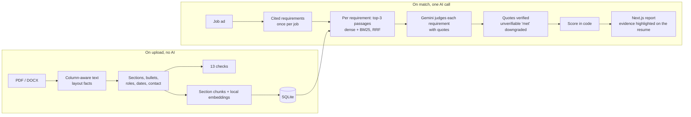

# Shortlist: show your real experience, clearly

Check how your resume reads to recruiters and tracking systems, match it to a job **requirement by requirement with quotes as evidence**, and improve bullets with suggestions that are **checked for invented numbers and skills**.

> This repository was the *AI Resume Assistant* (v1: Streamlit + FastAPI chatbot with an "ATS score"). Version 2 is a rebuild; see [what changed](#what-changed-from-v1).

**Live demo:** _coming soon (being deployed)_ · **Case study:** `/case-study` in the app · **Status:** working prototype; AI-matching eval pending an API key

## What it does

| | |
|---|---|
| **Review** | 13 explainable readability checks: text layer, contact details, headings, columns, tables and photos, length, bullet length, openers, numbers, pronouns, personal details, date formats. Each shows the lines involved and a fix. No made-up score. |
| **Profile** | Skills split into *shown in your work* and *only listed*, strongest achievements, and where the resume undersells you, all cited |
| **Match** | The job ad's requirements, each judged met / partly / not shown with resume quotes; coverage computed in code; instant keyword view while the AI runs |
| **Tailor** | Three rewrites per bullet aimed at the job, flags for anything the original doesn't say, a word diff, and a clean single-column Word export |
| **Ask** | Interview prep from your own resume, grounded in its lines |

## Architecture



- **Deterministic first:** parsing, layout, checks and keyword matching are instant, free, tested and work with AI off.
- **The model judges, code scores:** required items count double, partial evidence half; a "met" with an unverifiable quote becomes "partial".
- **Guardrails on rewrites:** numbers not in the original and skills that appear nowhere on the resume are flagged beside each suggestion.
- **Shared, tested core** with [Margin](https://github.com/anuj1102001/AI-Document-Summarizer): ingestion, hybrid retrieval, quote verification, workspace security, LLM client.

## Evaluation

No API key needed; both run in CI. Six synthetic resumes in different formats (one two-column PDF, one Word file), four job ads, and 74 hand-labelled requirement judgements. v1 is the original code, run unchanged.

| Parsing | v1 | v2 |
|---|---|---|
| Files parsed | 5/6 (no DOCX) | 6/6 |
| Section F1 | 0.732 | 1.0 |
| Name found | 0.5 | 1.0 |
| Contact details found | 0.533 | 1.0 |
| Roles extracted | not extracted | 6/6 |

| Requirement matching | v1 keywords | v2 keywords | v2 AI |
|---|---|---|---|
| Can assess | 0.5 | 0.838 | pending |
| Accuracy (3-class) | 0.216 | 0.622 | pending |
| Evidence F1 | 0.174 | 0.849 | pending |
| Over-claim rate | 0.0 | 0.0 | pending |

**Caveat:** v2 was developed while looking at these files, and the labels were written by the same person. These numbers show the v1-to-v2 change on known cases, not accuracy on unseen resumes. Details: [`backend/evals/results/`](backend/evals/results/). The AI column comes from `python -m evals.run_matching --llm` once a key is set.

## Run it locally

Requirements: Python 3.11+, Node 20+.

```bash
cd backend
python -m venv .venv && source .venv/bin/activate   # Windows: .venv\Scripts\activate
pip install -r requirements-dev.txt
cp .env.example .env        # add GEMINI_API_KEY, or set LLM_PROVIDER=offline-demo
uvicorn app.main:app --reload --port 8000
```

```bash
cd frontend
npm install
echo "NEXT_PUBLIC_API_URL=http://localhost:8000" > .env.local
npm run dev                 # http://localhost:3000
```

Without a key, upload, checks and keyword matching work; AI features say they're unavailable. `LLM_PROVIDER=offline-demo` fills them with rule-based placeholders, labelled as not AI.

## Tests and checks

```bash
cd backend && pytest && ruff check . && python -m evals.run_parsing && python -m evals.run_matching
cd frontend && npm test && npm run typecheck && npm run lint
```

42 backend tests, including gold-label parsing for each resume format and a fake model that misbehaves on purpose (invented evidence must be downgraded; inflated rewrites must be flagged).

## Deploy

- **Backend:** `backend/Dockerfile` runs on Hugging Face Spaces (Docker SDK, port 7860) or any container host. Secrets: `GEMINI_API_KEY`; set `CORS_ORIGINS` to the frontend URL.
- **Frontend:** Vercel (root directory `frontend`), `NEXT_PUBLIC_API_URL` set to the backend.

## Project layout

```
backend/
  app/ingest/     file detection, parsing, column-aware reading
  app/resume/     sections and roles, layout facts, readability checks, skill vocabulary, keyword view
  app/retrieval/  embeddings, BM25 + dense + RRF
  app/llm/        Gemini client, schemas, versioned prompts, offline demo
  app/services/   resumes, jobs, matching, rewrites and tailored versions, Q&A
  evals/          synthetic data, gold labels, v1 baselines, eval scripts and results
frontend/src/     dashboard, resume workspace, job, match report, case study
```

## What changed from v1

v1's requirements file was UTF-16 and missed five imported packages; the README described Ollama while the code called Groq; one global resume and chat history were shared by every visitor; job matching used 37 hard-coded substrings ("ai" matched inside "maintain"); the ATS score gave 10 points to any resume; the parser hard-coded the author's own job titles; chat failed whenever the model wrapped JSON in code fences; there were no tests. The original services are kept in `backend/evals/baselines/` only to measure against.

## Limitations and next steps

- Synthetic evaluation data; real, consented resumes labelled by someone else are the next step. AI-match eval pending a key. No usability testing yet (study plan in the case study).
- No OCR for image-only resumes; anonymous workspaces without accounts.

## Skills this project demonstrates

Document parsing and information extraction, hybrid RAG, LLM structured outputs with grounding and guardrails, evaluation design against a baseline, FastAPI and security, testing with adversarial model fakes, CI and Docker, and product design: explainable AI, honest metrics, interaction design for review and editing, accessibility.

Suited roles: AI Engineer, Generative AI Engineer, AI Application Developer, Product Designer, AI Product Designer.

## Author

**Anuj M** · [LinkedIn](https://www.linkedin.com/in/anuj1102001/) · [GitHub](https://github.com/anuj1102001)

Built with an AI coding assistant (Claude Code) under my direction: I set the product direction and requirements, and reviewed the design, code and evaluations.
